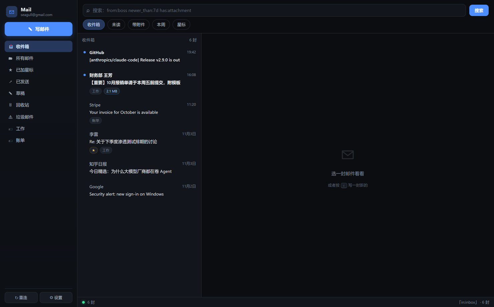

# gmail-imap-mcp

[](https://github.com/luojinghao6-art/gmail-imap-mcp/actions/workflows/ci.yml)
[](https://github.com/luojinghao6-art/gmail-imap-mcp/releases)
[](https://www.python.org/)
**Gmail for AI agents — App Password only. No OAuth, no Google Cloud project, no relay.**

English · [简体中文](README.zh-CN.md)

Your AI reads and sends your Gmail through plain IMAP/SMTP with a Google **App
Password**. One config file, `pip install`, done. No Google Cloud console, no
OAuth consent screen, no 7-day refresh-token expiry, no third-party server
seeing your mail.

Ships three front-ends over one core:

| | What it is | Why |
|---|---|---|
| **MCP server** | `gmail-imap-mcp` — 7 typed tools over stdio | AI understands it without reading docs. Works in Claude Desktop, Cursor, Cherry Studio, Cline, any MCP client |
| **Skill / CLI** | `gmail-imap` — one command per action | For agents that run shell commands (Claude Code, Codex, Aider) and for humans |
| **Web UI** | `gmail-imap-ui` — local three-pane mail client | When you'd rather click than prompt |

---

## Quick start

```bash
# install the release wheel (PyPI publication is pending)
pip install "gmail-imap-mcp[mcp] @ https://github.com/luojinghao6-art/gmail-imap-mcp/releases/download/v0.1.0/gmail_imap_mcp-0.1.0-py3-none-any.whl"
gmail-imap config                      # paste a Google App Password (16 chars)
```

Then point your AI at it — one line for any MCP client:

```bash
claude mcp add gmail -- gmail-imap-mcp
```

No App Password yet? [Create one here](https://myaccount.google.com/apppasswords)
— 2-Step Verification must be on first. Full details in [Configure](#configure).

## Why this exists

Most Gmail MCP servers fall into two camps, and both have a catch:

| Option | Catch |
|---|---|
| **Google's hosted Gmail MCP** (`gmailmcp.googleapis.com/mcp/v1`) | 23 tools, and **not one of them sends mail**. It requests `gmail.readonly` / `gmail.modify` / `gmail.labels` — no `gmail.send` scope. Drafts only |
| **Gmail API servers** (e.g. `google_workspace_mcp`) | Full power, but you must create a Google Cloud project, enable the Gmail API, configure an OAuth consent screen, download `client_secret.json`, and — while the app is in *Testing* — your refresh token dies every 7 days |
| **`GongRzhe/Gmail-MCP-Server`** | Very popular, **archived in March 2026**. Tutorials still recommend it |
| **Hosted aggregators** (Composio, Zapier) | No GCP setup, but your mail and tokens flow through a third party |

App Passwords have none of these problems. Google still supports them for
personal accounts with 2-Step Verification enabled, and they are exactly what
IMAP/SMTP expects.

**Trade-off, stated plainly:** App Passwords are being tightened over time, and
they do not exist for Google Workspace accounts whose admin disabled them. IMAP
also cannot edit filters, read Gmail settings, or modify an existing draft. If
you need those, use a Gmail API server.

## Features

- **Send, reply, reply-all** — HTML or plain text, multiple recipients, CC/BCC,
  attachments, and proper `In-Reply-To` / `References` so replies thread correctly
- **Search with Gmail's own syntax** via the `X-GM-RAW` IMAP extension:
  `from:boss newer_than:7d`, `has:attachment filename:pdf`, `label:Work`,
  `is:unread in:anywhere` — not the crippled subset of IMAP `SEARCH`
- **Batched header fetch** — one round trip per page instead of two per message
  (30 messages: ~25 s with the naive version, ~4 s now on a real account; the
  rest is TLS login plus one search round trip)
- **Attachment download** and save-to-disk
- **Localised folder names decoded** from IMAP modified UTF-7
  (`[Gmail]/&XfJSIJZkkK5O9g-` → `[Gmail]/已删除邮件`)
- **SOCKS5 proxy support** for networks where Gmail is blocked (`GMAIL_PROXY`)
- Core, CLI and Web UI are **standard library only**. Only the MCP server needs
  the `mcp` package

## Install

```bash
# from the v0.1.0 release wheel (no PyPI account needed)
pip install "gmail-imap-mcp[mcp] @ https://github.com/luojinghao6-art/gmail-imap-mcp/releases/download/v0.1.0/gmail_imap_mcp-0.1.0-py3-none-any.whl"

# or straight from the repo
pip install "git+https://github.com/luojinghao6-art/gmail-imap-mcp.git#egg=gmail-imap-mcp[mcp]"

# CLI only, zero dependencies
pip install "gmail-imap-mcp @ https://github.com/luojinghao6-art/gmail-imap-mcp/releases/download/v0.1.0/gmail_imap_mcp-0.1.0-py3-none-any.whl"
```

Once the package is on PyPI, the short form works too:
`pip install "gmail-imap-mcp[mcp]"` or `uvx --from "gmail-imap-mcp[mcp]" gmail-imap-mcp`.

Requires Python 3.9+.

## Configure

### 1. Create an App Password

1. Turn on **2-Step Verification**: <https://myaccount.google.com/security>
   (App Passwords do not exist without it)
2. Open <https://myaccount.google.com/apppasswords>
3. Create one named e.g. `gmail-imap`, copy the 16-character password

### 2. Save it

```bash
gmail-imap config
# Gmail address: you@gmail.com
# App Password (16 chars, hidden): xxxx xxxx xxxx xxxx
gmail-imap status
```

Credentials are stored at:

- Windows — `%APPDATA%\gmail-imap-mcp\credentials.json`
- macOS / Linux — `~/.config/gmail-imap-mcp/credentials.json`

with `0600` permissions. You can also skip the file entirely and set
`GMAIL_ADDRESS` / `GMAIL_APP_PASSWORD` environment variables — useful for
containerised MCP configs.

## Connect it to your AI

### Claude Desktop

`claude_desktop_config.json`:

```json
{
  "mcpServers": {
    "gmail": {
      "command": "uvx",
      "args": ["--from", "gmail-imap-mcp[mcp]", "gmail-imap-mcp"],
      "env": {
        "GMAIL_ADDRESS": "you@gmail.com",
        "GMAIL_APP_PASSWORD": "xxxx xxxx xxxx xxxx"
      }
    }
  }
}
```

Leave out `env` if you already ran `gmail-imap config`.

### Claude Code / Cursor / any MCP client

```bash
claude mcp add gmail -- uvx --from "gmail-imap-mcp[mcp]" gmail-imap-mcp
```

### As a Claude Code skill

Copy [`skill/SKILL.md`](skill/SKILL.md) to `~/.claude/skills/gmail/SKILL.md`.
The skill drives the CLI, so the agent picks it up automatically when the user
mentions email.

## Web UI



```bash
gmail-imap-ui            # opens http://127.0.0.1:8765/
gmail-imap-ui --port 9000 --no-browser
```

Three panes: folders, message list, reading pane. Compose with attachments,
reply / reply-all, Gmail-syntax search. Binds to `127.0.0.1` only and requires a
per-process token, so a random website cannot drive your inbox.

Email HTML is rendered inside a `sandbox` iframe with a strict CSP: **scripts in
an email do not run, and remote images do not load** (no tracking pixels). This
is deliberate.

## MCP tools

| Tool | What it does |
|---|---|
| `gmail_status` | Is it configured? Does IMAP login work? |
| `gmail_search(query, limit, mailbox)` | Gmail-syntax search, returns headers + uid |
| `gmail_read(uid, save_attachments_to?)` | Full message: text, HTML, attachment list |
| `gmail_send(to, subject, body, cc?, bcc?, html?, attachments?, reply_to_uid?)` | Send |
| `gmail_reply(uid, body, reply_all?)` | Reply, quoting the original, threading preserved |
| `gmail_labels()` | Folders and labels, decoded |
| `gmail_download_attachment(uid, index, save_to)` | Save one attachment to disk |

## CLI

```bash
gmail-imap status
gmail-imap search --query "from:boss newer_than:7d" --limit 10
gmail-imap read --uid 12345 --save-attachments ./attachments
gmail-imap send --to a@b.com --subject "Hi" --body "Hello"
gmail-imap send --to a@b.com --subject "Report" --body "See attached" --attach report.pdf
gmail-imap labels
```

Add `--json` to `search` / `read` / `labels` for machine-readable output.

## Security notes

- **Credentials are plaintext on disk.** That is the same model as `~/.netrc` or
  `~/.aws/credentials`. Restrict the file, never commit it, and revoke the App
  Password at Google if it leaks.
- **App Passwords grant full mailbox access.** They cannot be scoped down the way
  OAuth scopes can. Use a dedicated Google account if that matters to you.
- **Email is untrusted input.** A message can contain instructions aimed at your
  AI. `server.py` tells the model to treat email content as data, but prompt
  injection is not solvable with a sentence — review before letting an agent
  send mail on your behalf.
- **The web UI is localhost-only** and token-gated. Do not port-forward it.

## Troubleshooting

| Symptom | Cause |
|---|---|
| `534` / "Application-specific password required" | 2FA is off, or you used the account password |
| `535` / "Username and Password not accepted" | Wrong or revoked App Password (it is 16 chars, not your password) |
| Connection timeout | Gmail unreachable. Try `GMAIL_PROXY=socks5://127.0.0.1:7890` (`pip install PySocks`) |
| Search returns nothing that exists | Default scope is All Mail; try `in:anywhere`, or pass `mailbox="INBOX"` |
| Chinese folder names look like `&XfJSIJZkkK5O9g-` | Fixed — decoded automatically since 0.1.0 |

## Status

Working and dogfooded against a real personal Gmail account: search, read,
attachments, send, reply, web UI. Not covered yet: draft editing, filters,
Gmail settings (IMAP cannot do these), and automated tests against a live
mailbox.

Issues and PRs welcome. Please open an issue before large changes.

## License

MIT — see [LICENSE](LICENSE).
