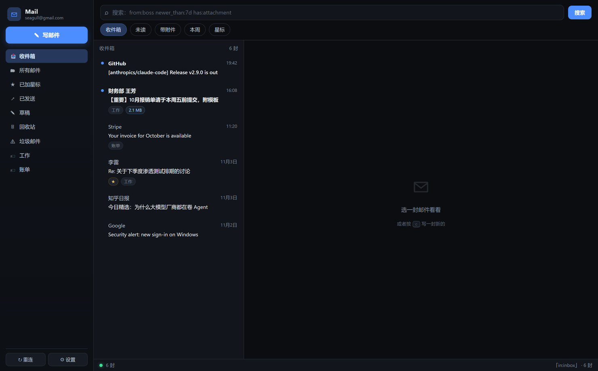

# gmail-imap-mcp

**给 AI 用的 Gmail —— 只走应用专用密码。不用 OAuth，不建 GCP 项目，不经过第三方中转。**

[English](README.md) · 简体中文

你的 AI 通过普通 IMAP/SMTP + Google **应用专用密码**收发 Gmail。写一个配置文件、
`pip install` 一次就完事。不用进 Google Cloud 控制台，不用配 OAuth 同意屏幕，
不会七天掉一次 refresh token，也没有第三方服务器能看见你的邮件。

底层一个核心，上面三张脸：

| | 是什么 | 为什么要有 |
|---|---|---|
| **MCP 服务** | `gmail-imap-mcp`，stdio 上 7 个带类型的工具 | AI 不用读文档就懂。Claude Desktop、Cursor、Cherry Studio、Cline 这些 MCP 客户端直接吃 |
| **Skill / CLI** | `gmail-imap`，一个动作一条命令 | 给能跑 shell 的 agent（Claude Code、Codex、Aider），也给人用 |
| **Web UI** | `gmail-imap-ui`，本地三栏邮件客户端 | 不想敲命令、想点着用的时候 |

---

## 三步上手

```bash
pip install "gmail-imap-mcp[mcp]"     # 也可以用 release 里的 wheel，见下文
gmail-imap config                      # 粘贴 16 位应用专用密码
```

然后让 AI 接上——任意 MCP 客户端一行搞定：

```bash
claude mcp add gmail -- gmail-imap-mcp
```

还没有应用专用密码？[去这里生成](https://myaccount.google.com/apppasswords)，
要先把两步验证打开。完整说明见[配置](#配置)。

## 为什么要有这个

市面上的 Gmail MCP 基本分两派，各有一个坑：

| 方案 | 坑在哪 |
|---|---|
| **Google 官方托管 Gmail MCP**（`gmailmcp.googleapis.com/mcp/v1`） | 23 个工具，**一个能发信的都没有**。它只申请 `gmail.readonly` / `gmail.modify` / `gmail.labels`，没有 `gmail.send`。天花板就是建草稿 |
| **Gmail API 系**（如 `google_workspace_mcp`） | 功能全，但你得建 GCP 项目、开 Gmail API、配 OAuth 同意屏幕、下 `client_secret.json`；而且应用在 *Testing* 状态下，refresh token 每 7 天过期一次 |
| **`GongRzhe/Gmail-MCP-Server`** | 最出名，但 **2026 年 3 月就归档了**，网上一堆教程还在推 |
| **托管聚合服务**（Composio、Zapier） | 不用碰 GCP，但邮件内容和 token 都要过它一手 |

应用专用密码这些毛病一个都没有。个人账号开了两步验证就能用，而且它本来就是
IMAP/SMTP 的标准认证方式。

**坑也直说：** 应用专用密码正在被 Google 逐步收紧；如果 Workspace 管理员禁用了它，
那你就用不了。另外 IMAP 改不了过滤器、读不到 Gmail 设置、也改不了已有草稿——需要这些
就得上 Gmail API。

## 功能

- **发信、回复、回复全部** —— HTML 或纯文本、多收件人、CC/BCC、附件，并且正确设置
  `In-Reply-To` / `References`，对方那边不会开新会话
- **用 Gmail 自己的搜索语法**，走 IMAP 的 `X-GM-RAW` 扩展：
  `from:boss newer_than:7d`、`has:attachment filename:pdf`、`label:工作`、
  `is:unread in:anywhere` —— 不是 IMAP `SEARCH` 那个残缺子集
- **批量取邮件头** —— 一页一次往返，而不是每封两次（真实账号上 30 封：旧写法约 25 秒，
  现在约 4 秒；剩下的时间主要是 TLS 登录和一次搜索往返）
- **附件下载**并存盘
- **中文文件夹名自动解码**（IMAP modified UTF-7）：
  `[Gmail]/&XfJSIJZkkK5O9g-` → `[Gmail]/已删除邮件`
- **SOCKS5 代理**，Gmail 被墙的时候用（`GMAIL_PROXY`）
- 核心、CLI、Web UI **只用标准库**；只有 MCP 服务需要 `mcp` 包

## 安装

```bash
# MCP 服务（顺带装上 CLI 和 Web UI）
uvx --from "gmail-imap-mcp[mcp]" gmail-imap-mcp

# 或者 pip
pip install "gmail-imap-mcp[mcp]"

# 只要 CLI，零依赖
pip install gmail-imap-mcp
```

需要 Python 3.9+。

## 配置

### 1. 生成应用专用密码

1. 打开两步验证：<https://myaccount.google.com/security>
   （不开两步验证就没有应用专用密码这个入口）
2. 进 <https://myaccount.google.com/apppasswords>
3. 随便起个名字比如 `gmail-imap`，把 16 位密码抄下来

### 2. 存起来

```bash
gmail-imap config
# Gmail address: you@gmail.com
# App Password (16 chars, hidden): xxxx xxxx xxxx xxxx
gmail-imap status
```

凭据存在：

- Windows —— `%APPDATA%\gmail-imap-mcp\credentials.json`
- macOS / Linux —— `~/.config/gmail-imap-mcp/credentials.json`

权限 `0600`。也可以完全不落盘，直接设 `GMAIL_ADDRESS` / `GMAIL_APP_PASSWORD`
环境变量——容器里跑 MCP 的时候方便。

## 接到你的 AI 上

### Claude Desktop

`claude_desktop_config.json`：

```json
{
  "mcpServers": {
    "gmail": {
      "command": "uvx",
      "args": ["--from", "gmail-imap-mcp[mcp]", "gmail-imap-mcp"],
      "env": {
        "GMAIL_ADDRESS": "you@gmail.com",
        "GMAIL_APP_PASSWORD": "xxxx xxxx xxxx xxxx"
      }
    }
  }
}
```

已经跑过 `gmail-imap config` 的话，`env` 整段可以不要。

### Claude Code / Cursor / 任意 MCP 客户端

```bash
claude mcp add gmail -- uvx --from "gmail-imap-mcp[mcp]" gmail-imap-mcp
```

### 当成 Claude Code 的 skill

把 [`skill/SKILL.md`](skill/SKILL.md) 拷到 `~/.claude/skills/gmail/SKILL.md`。
这个 skill 驱动 CLI，用户一提到邮件就会被自动激活。

## Web UI



```bash
gmail-imap-ui            # 打开 http://127.0.0.1:8765/
gmail-imap-ui --port 9000 --no-browser
```

三栏：文件夹、邮件列表、阅读区。能带附件写信、回复/回复全部、Gmail 语法搜索。
**只绑 `127.0.0.1`**，每个进程一个随机 token，随便哪个网站都调不动你的收件箱。

邮件 HTML 跑在 `sandbox` iframe 里并带严格 CSP：**邮件里的脚本不会执行，外部图片不会加载**
（防追踪像素）。这是故意的。

## MCP 工具

| 工具 | 作用 |
|---|---|
| `gmail_status` | 配好了没？IMAP 登得上吗？ |
| `gmail_search(query, limit, mailbox)` | Gmail 语法搜索，返回头信息和 uid |
| `gmail_read(uid, save_attachments_to?)` | 整封邮件：纯文本、HTML、附件列表 |
| `gmail_send(to, subject, body, cc?, bcc?, html?, attachments?, reply_to_uid?)` | 发信 |
| `gmail_reply(uid, body, reply_all?)` | 回复，带原文引用、保持会话 |
| `gmail_labels()` | 文件夹和标签，已解码 |
| `gmail_download_attachment(uid, index, save_to)` | 把一个附件存到磁盘 |

## CLI

```bash
gmail-imap status
gmail-imap search --query "from:boss newer_than:7d" --limit 10
gmail-imap read --uid 12345 --save-attachments ./附件
gmail-imap send --to a@b.com --subject "标题" --body "正文"
gmail-imap send --to a@b.com --subject "周报" --body "见附件" --attach 周报.pdf
gmail-imap labels
```

`search` / `read` / `labels` 加 `--json` 拿机读输出。

## 安全须知

- **凭据是明文落盘的。** 跟 `~/.netrc`、`~/.aws/credentials` 一个模型。把文件权限收好，
  别提交到仓库，泄露了就去 Google 那边吊销这个应用专用密码。
- **应用专用密码等于整个邮箱的权限。** 它不像 OAuth scope 那样能收窄。介意的话，
  单独开个 Google 账号专门给它用。
- **邮件是不可信输入。** 一封邮件里可以写着专门骗你 AI 的指令。`server.py` 里让模型
  把邮件内容当数据看，但提示注入不是一句话能解决的——让 agent 替你发信之前自己看一眼。
- **Web UI 只监听本机**，且有 token 校验。别往公网转发。

## 排障

| 现象 | 原因 |
|---|---|
| `534` / "Application-specific password required" | 没开两步验证，或者用的是账号密码 |
| `535` / "Username and Password not accepted" | 应用专用密码错了或被吊销（是 16 位，不是登录密码） |
| 连接超时 | 到不了 Gmail。试试 `GMAIL_PROXY=socks5://127.0.0.1:7890`（先 `pip install PySocks`） |
| 明明有邮件却搜不到 | 默认搜的是「所有邮件」，试试 `in:anywhere`，或者传 `mailbox="INBOX"` |
| 中文文件夹显示成 `&XfJSIJZkkK5O9g-` | 已修——0.1.0 起自动解码 |

## 现状

已在真实个人 Gmail 账号上跑通：搜索、阅读、附件、发信、回复、Web UI。
还没做：草稿编辑、过滤器、Gmail 设置（IMAP 干不了这些），以及针对真实邮箱的自动化测试。

欢迎提 issue 和 PR。大改动请先开 issue 聊。

## 许可证

MIT —— 见 [LICENSE](LICENSE)。
